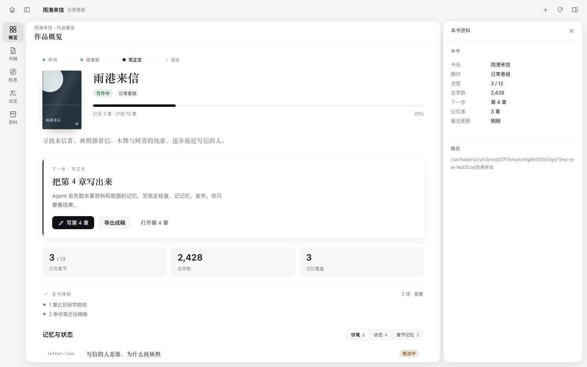
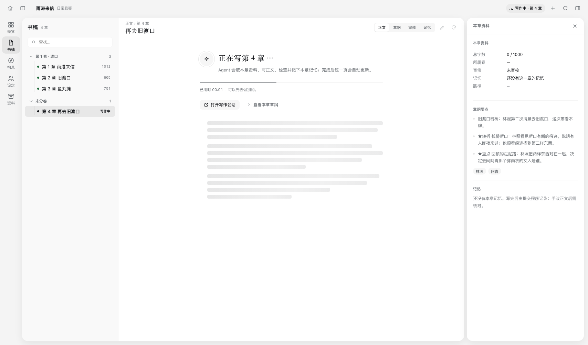
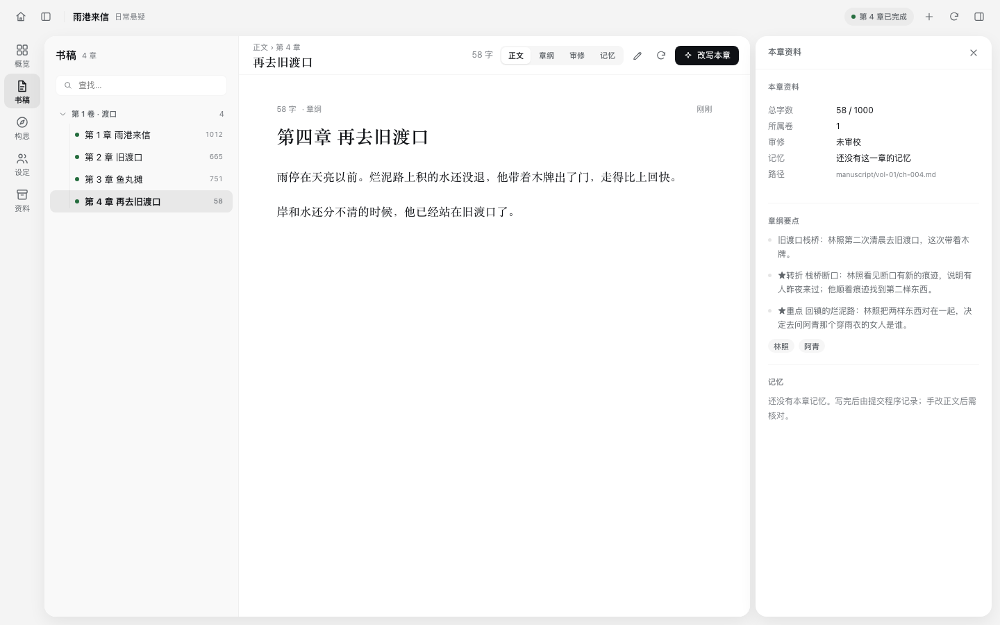

# Narracat · 叙述猫

**DeepSeek Harness（DSH）里的长篇小说工作台：从一句话开书，写到完本。**

> English: A full-flow novel workbench for DeepSeek Harness — shelf, premise, outline, drafting, visible chapter memory, review and export. One next step at a time. The book stays a local `.narracat` directory; the workbench is just a view.

[](https://www.npmjs.com/package/narracat-dsh-workbench)
[](LICENSE)
[](https://github.com/yannikzz/narracat-dsh-workbench/actions/workflows/ci.yml)


官网：[narracat.com/dsh](https://narracat.com/dsh) · npm：[narracat-dsh-workbench](https://www.npmjs.com/package/narracat-dsh-workbench)


---

## 它是什么

Narracat 把一部长篇小说的创作流程收进一个 DSH 工作台：

- **书是文件**：作品就是一个 `.narracat` 目录，正文、章纲、人物、记忆、追踪表都在磁盘上；不导入、不复制、不改原文件。
- **只有一个下一步**：概览最显眼的位置永远是一张下一步卡——开始立项、规划全书大纲、写第 N 章、完本并导出。导航不伪装成执行，一屏不并列三个主按钮。
- **看得见的记忆**：`tracking/` 下有进度、章节摘要、伏笔表、人物状态四张自动表，加上一份作者可编辑的写作备忘。Agent 写下一章前先读记忆简报。
- **写章是等待现场**：点「写本章」后，正文页显示正在写第 N 章、用时、进度与骨架正文；切页面/刷新后按书恢复，写完自动把成稿加载出来。右侧小说面板复用同一套紧凑等待卡。
- **直接改**：正文与设定可以直接编辑，保存前核对文件修改时间；别人改过就拒绝覆盖。
- **四格式导出**：Word（.docx）、可打印 HTML、Markdown、TXT；导出前先看全书体检。



## 安装

推荐在 DSH 的图形界面里安装；也可以使用 CLI 或让 Agent 安装。

### 1. 图形界面（推荐）

1. 打开 DSH → 左侧「**插件**」→「**添加插件**」；
2. 输入包名 `narracat-dsh-workbench`；
3. 安装后**重启 DSH**，左侧栏会出现「Narracat · 叙述猫」。

### 2. CLI

```bash
# <profile> 必须换成你自己的 profile 名；桌面版通常为 desktop
dsh plugin --profile <profile> add narracat-dsh-workbench
```

> DSH 0.2.2-rc.5 的 `dsh plugin` 要求 `--profile <name>`；不能原样运行 `<profile>`。

### 3. Agent 会话内

```text
plugin_manager install_bundle target=narracat-dsh-workbench
```

### 4. 离线 tarball

从 [Releases](https://github.com/yannikzz/narracat-dsh-workbench/releases) 下载 `narracat-dsh-workbench-<version>.tgz`，然后：

```bash
dsh plugin --profile <profile> add /absolute/path/to/narracat-dsh-workbench-<version>.tgz
```

**要求**：DSH `>=0.2.2-rc.5 <0.3.0`，Node `>=20`（CLI）。安装/升级后需要重启 DSH；client bundle 在启动时快照，只刷新页面可能仍加载旧 bundle。

## 快速开始

1. 在 DSH 里打开一个工作区，放入你的作品目录，例如 `我的书/.narracat/config.yaml`；或者直接在插件里「新建作品」。
2. 左侧栏点「Narracat · 叙述猫」。
3. 点「新建作品」：填书名、题材、一句话想法、计划章数、每章字数。建完自动打开新书，下一步是「开始立项」。
4. 跟着下一步卡走：立项 → 规划大纲 → 写第 1 章 → …… → 完本并导出。
5. 想改已发布的章：章节页点「改写本章」，Agent 先开改写稿，改完再提交替换，不碰正式正文。



## 写作流程

```text
取本章资料（章纲 / 人物状态 / 前文 / 伏笔）
        ↓
写草稿到 .narracat/staging/
        ↓
检查（字数 / 正文卫生 / 记忆完整性）
        ↓
记本章记忆 → 发布正式正文
        ↓
刷新追踪表（进度 / 摘要 / 伏笔 / 人物状态）
```

- Agent 只能经程序写：正文、记忆、大纲、审校、设定、立项卡都由 Host 的提交程序写入；Agent 的文件工具被宿主拦住，不能直接改 `manuscript/`、`memory/`、`reviews/`、提交日志。
- 写作是线性的：一次只跑一章；中途提问时状态变「等待你回答」。
- 完成检测：会话状态优先，另每 4 秒轻量查询一次作品；看到本章正文出现就自动加载到当前正文页。



## 仓库结构

```text
.
├── novel-workbench/        # 可安装的 DSH bundle（npm 包本体）
│   ├── index.js            # Host：同源 JSON API
│   ├── agent.js            # Agent：小说工具、Skill、系统提示
│   ├── client.js           # Client：书架 + 工作台 + 右侧面板
│   ├── lib/                # 作品读取、提交、导出、追踪、记忆
│   ├── src/client/         # Client 源码片段（构建 client.js）
│   ├── skills/ agents/ schemas/ templates/
│   └── docs/ locale/ icon.svg
├── dev/                    # 构建与无浏览器回归测试
├── demo/雨港来信/          # 虚构样例书（测试与截图使用）
├── docs/                   # 产品、架构、发布与截图
└── market/                 # DSH 自定义插件索引（npm source）
```

## 开发

要求 Node.js `>=20`。仓库没有运行时依赖，不需要 `npm install`。

```bash
npm run build     # 从 src/client/*.js 生成 novel-workbench/client.js
npm run check     # 语法检查 Host / Agent / Client
npm test          # 8 个回归套件
npm run pack:bundle
```

`npm test` 覆盖：

| 套件 | 断言数 | 覆盖 |
| --- | ---: | --- |
| `dev/test-ui.mjs` | 106 | 书架、工作台、写作等待态、侧边栏、工具提示、Tab、页面恢复 |
| `dev/test-agent.mjs` | 140 | 38 个工具、16 个 Skill、提交三态、记忆、审校、实体/本体 |
| `dev/test-api.mjs` | 67 | 书架/书模型/文件读写/CAS/越权/建书/导出/追踪 |
| `dev/test-flow.mjs` | 14 | 不开 DSH 的完整流程与导出 |
| `dev/test-tracking.mjs` | 20 | 记忆折叠、四张追踪表、备忘、写作简报 |
| `dev/test-bundle.mjs` | 28 | manifest、构建一致性、Skill 目录、分发资源 |
| `dev/test-scan.mjs` | 13 | 样例书读取、字数/配置、写保护 |
| `dev/test-submission.mjs` | 8 | 提交路径穿越、反斜杠穿越、审校路径拦截 |

合计 **396 项断言**。测试使用 `demo/雨港来信`，不会读取你的真实作品。

### 修改 Client

Client 是 `novel-workbench/src/client/*.js` 片段，通过 `npm run build` 合并成 `novel-workbench/client.js`。提交前请重新构建并运行 `npm test`；`test-bundle` 会检查构建文件与片段是否一致。

### 提交 Pull Request

- 保持改动聚焦；UI 改动附截图（使用样例书，不要用真实作品）。
- 改 Client 后运行 `npm run build`；不要手改 `client.js`。
- 新增用户可见行为时更新 `novel-workbench/CHANGELOG.md`。
- 不要提交 `dist/`、生成预览、真实作品或个人路径。
- 详见 [CONTRIBUTING.md](CONTRIBUTING.md)。

## 兼容与数据

- **兼容**：DSH `>=0.2.2-rc.5 <0.3.0`；DSH Desktop / CLI。DSH 仍在快速演进，破坏性变更会在 `engines.dsh` 中体现。
- **重启**：安装/升级后重启 DSH；client bundle 在启动时快照。
- **数据**：作品以 `.narracat` 目录留在本机，插件不另建云端副本；Agent 写作时会把必要的本章/记忆上下文发送给**你在 DSH 中配置的模型服务**。导出文件写在本地 `exports/`。
- **安全**：Host 对路径、符号链接、大小写变体、大小限制和写保护做围栏；提交程序检查字数、卫生与记忆完整性。详见 [SECURITY.md](SECURITY.md)。

## 文档

- [使用指南（novel-workbench/docs/GUIDE.md）](novel-workbench/docs/GUIDE.md)
- [架构说明（docs/ARCHITECTURE.md）](docs/ARCHITECTURE.md)
- [产品全流程（docs/PRODUCT-FULL-FLOW.md）](docs/PRODUCT-FULL-FLOW.md)
- [追踪式记忆（docs/MEMORY-TRACKING.md）](docs/MEMORY-TRACKING.md)
- [发布流程（docs/RELEASING.md）](docs/RELEASING.md)
- [更新日志（novel-workbench/CHANGELOG.md）](novel-workbench/CHANGELOG.md)
- [bundle README（novel-workbench/README.md）](novel-workbench/README.md)

## 贡献与许可

- 贡献指南：[CONTRIBUTING.md](CONTRIBUTING.md)
- 安全报告：[SECURITY.md](SECURITY.md)
- 行为准则：[CODE_OF_CONDUCT.md](CODE_OF_CONDUCT.md)

MIT。第三方写作技法引用的许可见 [NOTICE](NOTICE)。Narracat · 叙述猫与 DeepSeek 官方无隶属关系；DeepSeek Harness 是 DeepSeek 的开源项目。
